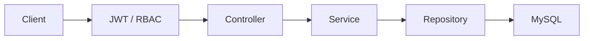

# E-Commerce Backend

Java 17 / Spring Boot REST API for catalog, customer accounts, checkout, and inventory management.

## Architecture



A layered monolith keeps deployment and transaction boundaries simple. Controllers validate HTTP requests, services own business rules, and repositories handle persistence. DTOs separate API contracts from database entities.

## Run locally

Prerequisites: Docker and Docker Compose. The Compose stack starts MySQL and Redis along with the API. Copy `.env.example` to `.env`, replace the passwords, and generate a random JWT secret of at least 32 bytes (for example, `openssl rand -hex 32`).

```sh
docker compose up --build
```

- API: http://localhost:8080
- OpenAPI UI: http://localhost:8080/swagger-ui/index.html
- Health: http://localhost:8080/actuator/health

Flyway initializes a **new, empty MySQL database**. Do not point this version at a legacy database created with Hibernate auto-update without a reviewed migration and backup. Hibernate validates the schema rather than changing it automatically.

## Deploy on Render

The Blueprint in `render.yaml` explicitly selects free web and Key Value plans in the Singapore region. Redis is private to the workspace. Render generates the JWT signing secret. An external, fresh MySQL-compatible database is required; enter the JDBC URL, username and password in the Render Dashboard during Blueprint setup. Use TLS with an external database and do not commit credentials. Test the database's Flyway and locking compatibility before using it for this application.

Free services may cold-start and are subject to provider quotas. Review any usage-based charges and set appropriate spending controls in the hosting dashboard.

## API

| Method | Endpoint | Access |
|---|---|---|
| POST | /auth/register, /auth/login | Public |
| GET | /products?page=0&size=20&sort=price&direction=asc | Public |
| GET | /products?keyword=book or /products?categoryId=1 | Public |
| GET | /products/{id}, /categories, /categories/{id} | Public |
| POST | /products, /categories | Admin |
| GET / PUT | /users/profile | Authenticated |
| POST | /orders | Authenticated; Idempotency-Key required |
| GET | /orders?page=0&size=20, /orders/{id} | Owner |
| PUT | /orders/{id}/status | Admin |

Register a customer through `POST /auth/register` and send the returned token as `Authorization: Bearer TOKEN`. Registration always assigns CUSTOMER. For local development only, create an account and promote it using a privileged database connection:

```sql
UPDATE users SET role = 'ADMIN' WHERE email = 'admin@example.com';
```

Checkout accepts:

```json
{
  "items": [{"productId": 1, "quantity": 2}],
  "shippingAddress": "123 Main Street",
  "shippingCity": "Hyderabad",
  "shippingState": "Telangana",
  "shippingZipCode": "500001"
}
```

## Engineering decisions

- JWT authentication is stateless; role and account existence are checked against the database. Product/category writes and order status changes require ADMIN. Order reads are scoped to their owner.
- Checkout is a single transaction. Pessimistic row locks are acquired in ascending product ID order; concurrent buyers cannot reserve the same stock. Duplicate product lines are merged. A failed checkout rolls back inventory changes.
- A customer-scoped idempotency key and request fingerprint prevent duplicate orders on retries. Reusing a key with a changed payload returns a conflict. Replays return the existing order, including its current status.
- Prices are captured at purchase using BigDecimal. Cancellation restores stock under locks; allowed status transitions are explicit.
- Catalog requests have bounded pages and allowlisted sorting. Category data is fetched with an entity graph. Leading-wildcard search is suitable for small catalogs, not a replacement for full-text search.
- Order history is paginated, with batched lazy association loading to reduce repeated queries.
- Optional Redis cache-aside for the category list uses a two-minute TTL and invalidation after category creation. Redis failures fall back to MySQL; checkout and product stock are never cached. A concurrent cache fill can temporarily serve stale category metadata until the TTL expires.
- Flyway owns schema changes. Secrets are supplied through environment variables. Open Session in View is disabled.

## Tests and performance

GitHub Actions runs Maven verification and publishes test and coverage reports. The CI smoke job starts a disposable Docker Compose stack, seeds 100 categories and 1,000 products, and compares cached and uncached catalog requests (10 virtual users, 30 seconds per mode). Measured latency and throughput are published as a workflow summary and JSON artifacts. Results from shared runners are illustrative, not production capacity estimates. Run `k6 run perf/catalog.js` locally against a running API for a smoke benchmark.

Prerequisites: Java 17, Maven and Docker (for Testcontainers). No external database credentials are required for the tests.

```sh
mvn -B verify
```

The suite includes service unit tests and MySQL-backed tests for anonymous access, ownership, validation, concurrent checkout, rollback, idempotency, and cancellation. JaCoCo reports are generated under `target/site/jacoco/`.

## Limitations

This is a portfolio application, not a payment-processing service. It does not yet implement payment, refresh tokens, rate limiting, or production load benchmarks. The optional Redis cache is limited to category metadata. Database locking favors correctness over maximum checkout throughput. External deployment requires a compatible database and environment configuration.
